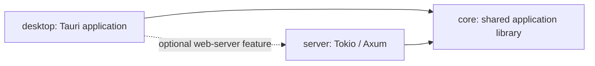
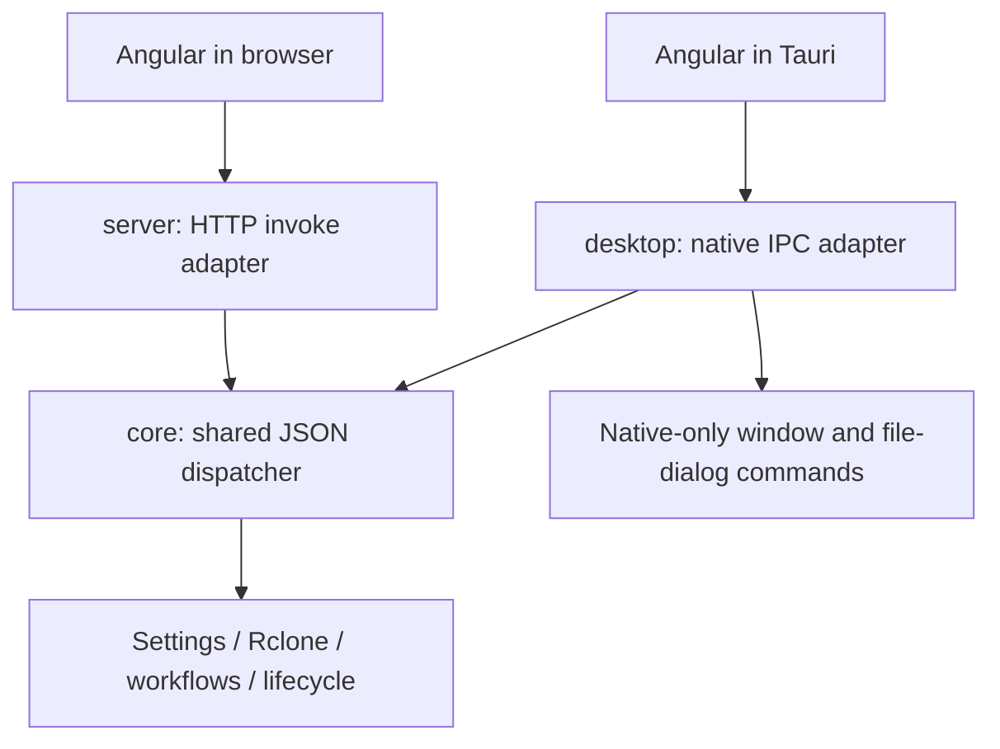

# RClone Manager System Architecture

RClone Manager has one Angular frontend and a Rust workspace containing shared
application services, a web server, and a native Tauri application. The same
operations are available through native IPC and the HTTP command endpoint.

## Rust workspace and dependencies

```text
backend/
├── Cargo.toml                  Workspace members and package version
├── Cargo.lock                  Shared dependency lockfile
├── core/
│   ├── src/app/                Bootstrap and shared command contract
│   ├── src/services/           Settings, security, workflows and lifecycle
│   ├── src/rclone/             Engine, transports, operations and caches
│   ├── src/context/            Shared state ownership and host contract
│   ├── src/utils/              Shared types and utilities
│   └── build.rs                Optional librclone build and linking
├── server/
│   ├── src/headless/           Process runtime, paths and restart
│   └── src/web/                Axum routes, auth, SSE and streaming
└── desktop/
    ├── src/app.rs              Native composition root
    ├── src/context.rs          Access to shared state from Tauri
    ├── src/native/             IPC, plugins, protocols and OS adapters
    ├── src/desktop/            Windows, tray and desktop integrations
    ├── gen/android/           Android application
    ├── tauri.conf*.json        Native packaging configuration
    └── build.rs                Tauri setup and Android library packaging
```



The core crate depends on neither Tauri nor Axum. The server does not import the
native crate. The native application can optionally depend on the server crate
to combine a local tray with HTTP access. Mobile stays in the native crate
because it uses the same Tauri host and shared application services.

| Build            | Package                                          | Executable / artifact                          |
| ---------------- | ------------------------------------------------ | ---------------------------------------------- |
| Desktop          | `rclone-manager`                                 | `rclone-manager`                               |
| Pure server      | `rclone-manager-server`                          | `rclone-manager-server`                        |
| Server with tray | `rclone-manager`, with `web-server,tray,updater` | Tauri packages it as `rclone-manager-headless` |
| Shared services  | `rclone-manager-core`                            | Library                                        |
| Mobile           | Native package with `mobile`                     | Platform application and native library        |

Windows executables add `.exe`. Cargo output lives under `backend/target`.
The source layout is independent of release availability: an older headless
package does not become a pure server merely because the repository was split.

## Shared application context

`core/src/context` defines the application's own `AppHandle`, typed state
access and `Host` capability contract. This handle is not `tauri::AppHandle`.
Cloned handles share registered state and the exit notification channel.

The process entry point creates the context and injects its host. Shared
bootstrap registers settings, the Rclone backend manager, caches, automation,
alerts and updater state. The native composition root registers that same context
in Tauri. `desktop/src/context.rs` provides `BackendContext` to access it from
native handles; business state is not duplicated between two state containers.

Host implementations supply the runtime-specific behavior:

- Resolve application paths and prepare the native environment.
- Exit or restart the application.
- Present exit confirmation where a native window is available.
- Integrate themes, tray visibility, autostart and native notifications.
- Check native updates and provide an installer through `AppUpdate`.

The pure server has no native exit-confirmation window. Explicit quit requests
use the shared shutdown sequence even when jobs, mounts or serves are active.

## One command contract, two adapters

Shared commands are declared in `core/src/app/commands.rs` through
`MASTER_COMMAND_LIST!`. `core/src/app/dispatch.rs` expands the catalog into a
JSON dispatcher that decodes camelCase arguments, injects the shared context,
calls the operation and serializes its result or error.



Shared service functions do not carry Tauri command attributes. Native-only
commands stay in the desktop crate and are registered with Tauri's handler
mechanism. The old `bridge-macro` proc-macro crate is no longer required.

The dispatcher preserves serialized domain errors, including localization keys
and parameters. A refactor must not replace these with an error's display string,
which can lose information needed by the frontend.

To add an operation for both transports, implement it in the shared crate and
register it in the shared command catalog. Put HTTP request/response details in
`server/src/web`, and OS dialogs or window manipulation in the native adapter.

## Events and frontend subscriptions

`core/src/services/bridge/event.rs` defines `EventBridge`. It serializes each emitted
payload and makes it available to a Tokio broadcast channel and an optional
injected `EventSink`.

- The native `WebviewEventSink` forwards events to Tauri webviews.
- The HTTP host subscribes to the broadcast channel. Its SSE handler forwards
  only names declared in `SSE_FORWARD_EVENTS`.
- Shared event constants live in `core/src/utils/types/events.rs`.
- Internal system integration subscriptions remain centralized in
  `core/src/services/event_listener.rs`. Tray refresh requests use events and host
  capabilities rather than direct imports of desktop modules.

On the frontend, `EventListenersService` owns native and SSE subscriptions.
Components and domain services consume its typed observables instead of creating
independent IPC listeners or SSE connections.

## Runtime and background tasks

The standalone server owns a Tokio runtime. The desktop executable registers its
Tokio runtime with the shared task helpers and Tauri before starting the native
event loop. Native UI callbacks may run outside Tokio worker threads.

Use `crate::utils::spawn` and `crate::utils::spawn_blocking` in shared and native
application code. These helpers establish the runtime context needed by background
work and return standard Tokio task handles. Do not replace them with raw
`tokio::spawn` in OS callbacks or setup hooks.

The shared lifecycle coordinates engine startup, vault-deferred initialization,
automations and shutdown. Closing or hiding a desktop window is distinct from
stopping the application and its running operations.

## Rclone and application subsystems

| Location under `backend/core/src` | Responsibility                                           |
| --------------------------------- | -------------------------------------------------------- |
| `rclone/backend`                  | Rclone transport implementations and backend connections |
| `rclone/engine`                   | Engine lifecycle and polling                             |
| `rclone/commands`                 | File operations, transfers, mounts, serves and jobs      |
| `rclone/state`                    | Shared caches and observed engine state                  |
| `core/settings`                   | `rcman` settings, profiles, vault and backups            |
| `core/automation`                 | Schedules and filesystem watchers                        |
| `core/flow`                       | Quick runs and workflow execution                        |
| `core/alerts`                     | Alert rules, history and notification action dispatch    |
| `core/lifecycle`                  | Startup/shutdown coordination and update scheduling      |
| `core/power`                      | Platform power operations and supported sleep inhibition |

`RcloneTransport` separates operations from their engine connection. HTTP
transports communicate with local or configured remote Rclone daemons; the
embedded transport uses librclone where enabled. `RoutingTransport` selects the
active backend. The optional native tray reads snapshots of shared state and
builds menus under `desktop/src/desktop/tray`.

Application update download and staging logic lives in
`core/src/utils/app/update_install.rs`; native updater checks and the Tauri
installer adapter live in `desktop/src/native/updater.rs`. The pure server
is updated by replacing its deployment, not through a native self-installer.
Rclone engine updates have their own lifecycle.

## Native and HTTP file access

Native custom protocols live in `desktop/src/native/protocol.rs`. HTTP file
and media endpoints live in `server/src/web/handlers`. Both reuse shared Rclone
operations, while keeping transport-specific response bodies and range handling
inside their own crate.

File-manager integration templates belong to `core/resources/send_to`.
Native single-instance handling belongs to the Tauri host; the pure server does
not acquire that plugin by depending on shared upload operations.

## Resources, paths and localization

All translations remain in the repository's `resources/i18n` directory. Tauri
resource mappings and standalone deployment layouts expose them to their host.
The pure server embeds the compiled frontend and these translations in its executable.

Backend errors carry localization keys and parameters for the frontend to
resolve. Rust caches only the translation subsets needed by OS integrations and
backend presentation; it does not pre-translate command errors. Application
settings keep the `rclone-manager` namespace independently of Cargo crate names.
Changing source directories must not migrate user data implicitly.

Authentication, TLS and deployment settings are described in
[headless configuration](../platform/configuration-headless.md). Authentication
is optional and requires a username/password pair; do not assume that choosing a
server build enables it automatically.

## Build responsibilities and boundary checks

`core/build.rs` owns the optional Go library build/link step and emits its library
path as Cargo metadata. `desktop/build.rs` uses that metadata for Android
packaging and runs Tauri's build preparation. There is no server build script
because it has no additional preparation beyond its dependencies.

Source boundary checks live in `core/tests/architecture.rs`. Dispatcher, event
sink, state-sharing and host-exit coverage lives beside the relevant shared code;
native and HTTP tests remain with their adapters. Test definitions are not proof
that a particular checkout has passed validation.

Use separate package checks for native and server builds. Checking only the whole
workspace can unify features and hide a dependency on an optional capability.
See [building from source](../getting-started/building.md) for commands and
[packaging](../user-guide/packaging.md) for distribution layouts.

The state access methods are defined directly on `AppHandle`; no shared `Manager`
trait is required. `State<T>` owns an `Arc<T>` and does not borrow the context.
Shared services live in `core/src/services`, while `core/src/app` composes them.
The native and server crates expose entry points; import shared APIs directly from
`rclone_manager_core` instead of through a runtime crate.
