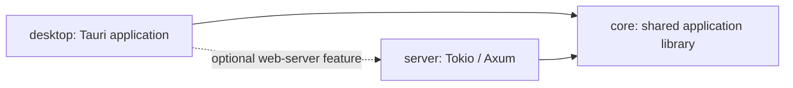
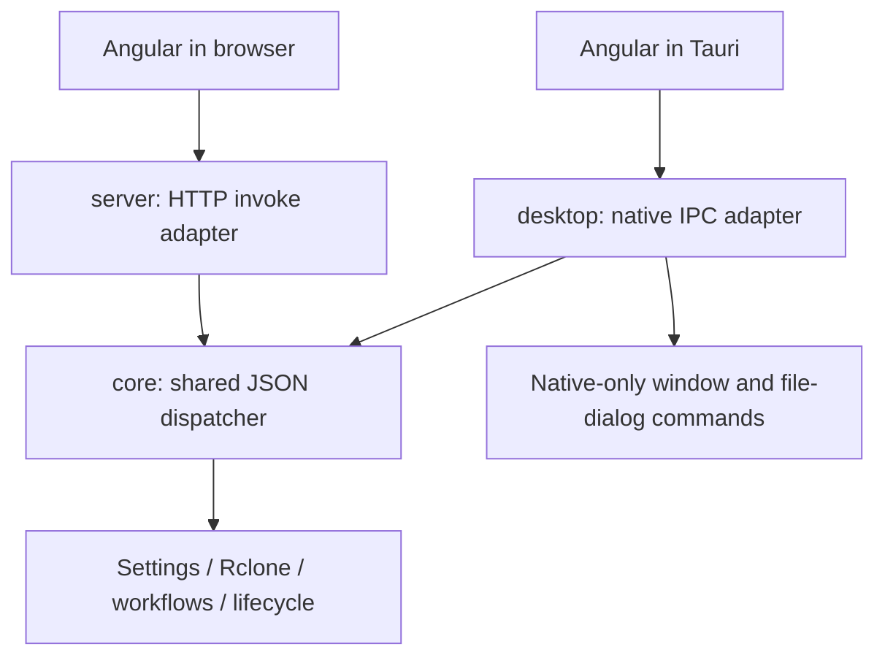
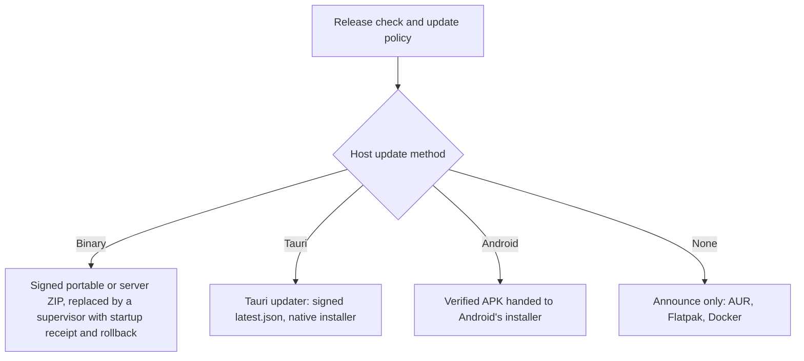

# RClone Manager System Architecture

RClone Manager is one Angular frontend and a Rust workspace. The workspace holds
shared application services, a web server and a native Tauri application. The same
frontend runs in a Tauri webview (desktop and Android) and in a browser against the
HTTP server, and the same operations are reachable through native IPC and the HTTP
command endpoint.

This page is a conceptual map of how the pieces fit. Contributor rules for the Rust
code live in
[`backend/ARCHITECTURE.md`](https://github.com/Zarestia-Dev/rclone-manager/blob/master/backend/ARCHITECTURE.md),
and the application update design in
[`backend/UPDATES.md`](https://github.com/Zarestia-Dev/rclone-manager/blob/master/backend/UPDATES.md).

## Rust workspace and dependencies

```text
backend/
├── Cargo.toml, Cargo.lock      Workspace members, shared dependency versions, package version
├── ARCHITECTURE.md, UPDATES.md Contributor guide and update design
├── core/                       Shared application, independent of Tauri and Axum
│   ├── src/app/                Bootstrap, command catalog, JSON dispatch and Send To
│   ├── src/services/           Settings, vault, automation, workflows, alerts, lifecycle, updates
│   ├── src/rclone/             Backends, engine, commands, queries, state and binaries
│   ├── src/context/            Shared state ownership and host contract
│   ├── src/utils/              Shared types, helpers and OS utilities
│   ├── resources/              OAuth, serve and send_to templates
│   ├── librclone_patches/      Go patches compiled into librclone
│   ├── librclone/              Generated librclone output (not committed)
│   ├── tests/architecture.rs   Source boundary checks
│   └── build.rs                librclone build and linking
├── server/                     Tokio/Axum executable and reusable HTTP host
│   ├── src/service/            Process runtime, signals, paths and restart
│   ├── src/web/                Routes, authentication, access control, SSE and handlers
│   ├── linux/, package/        systemd service template and packaging notes
│   └── build.rs                Embeds the compiled Angular UI
└── desktop/                    Tauri application, including mobile and packaging
    ├── src/app.rs              Native composition root
    ├── src/context.rs          Access to shared state from Tauri handles
    ├── src/native/             IPC, plugins, protocols, notifications and updater adapter
    ├── src/desktop/            Windows, tray, autostart and desktop paths
    ├── gen/android/            Android application (Kotlin)
    ├── linux/, windows/        Package scripts, desktop templates and installer hooks
    ├── tauri.conf*.json        Native resources and packaging configuration
    └── build.rs                Tauri setup and Android library packaging
```



The core crate depends on neither Tauri nor Axum. The server does not import the
native crate. The native application can optionally depend on the server crate to
combine a local tray with HTTP access. Mobile stays in the native crate because it
uses the same Tauri host and shared application services. The server crate enables
core's `updater` feature, so a standalone server can update itself.

| Build            | Package                                          | Executable / artifact                          |
| ---------------- | ------------------------------------------------ | ---------------------------------------------- |
| Desktop          | `rclone-manager` (default `desktop,tray`)        | `rclone-manager`                               |
| Portable         | `rclone-manager`, with `portable`                | Desktop executable that updates itself         |
| Flatpak          | `rclone-manager`, with `flatpak`                 | Desktop build with Flatpak adjustments         |
| Server           | `rclone-manager-server` (tray except on macOS)   | `rclone-manager-server`                        |
| Shared services  | `rclone-manager-core`                            | Library                                        |
| Mobile           | `rclone-manager`, with `mobile`                  | Android application and native library         |

Windows executables add `.exe`. Cargo output lives under `backend/target`. The
desktop and server products share one code base and differ by a `ProductInfo`
value (display name, release prefix, integration key and Flatpak ID), so names such
as release assets and file manager entries follow the product that runs. See
[building from source](../getting-started/building.md) for the commands.

## Shared application context

`core/src/context` defines the application's own `AppHandle`, typed state access and
the `Host` capability contract. This handle is not `tauri::AppHandle`. Cloned
handles share registered state and the exit notification channel. The state access
methods are defined directly on `AppHandle`; no shared `Manager` trait is needed,
and `State<T>` owns an `Arc<T>` instead of borrowing the context.

The process entry point creates the context and injects its host.
`core/src/app/setup.rs` then registers the shared state once: the
update health receipt, the event bridge, application paths and logging, the `rcman`
settings manager, the vault access boundary, the backend manager, the Rclone engine
state with its routing transport, automation (schedules, watchers, runtime tasks),
alert caches and dispatch, updater and provisioning state, and the power inhibitor
on desktop. It finishes by starting asynchronous initialization. The native
composition root registers that same context in Tauri, and
`desktop/src/context.rs` provides `BackendContext` to reach it from native handles,
so business state is never duplicated in two containers.

Host implementations supply the runtime-specific behavior. Required: path resolution
and restart. Optional, with defaults for hosts that do not have them:

- Exit, exit confirmation (the default proceeds), cleanup and native preparation.
- Theme, tray visibility, autostart and native notifications.
- The update method (`Binary`, `Tauri` or none), whether the build is portable, the
  Linux package format of a Tauri build, the native update check and restarting into
  an updated binary.

The pure server has no native exit-confirmation window, so explicit quit requests
use the shared shutdown sequence even when jobs, mounts or serves are active.

### Initialization

Initialization runs once, in the background, after the context is registered:

1. If the configuration vault is locked, only the language and the update health
   receipt are prepared. Everything else is postponed until the vault is unlocked.
2. Phase 0 loads the settings, the language and logging. Phase 1 (bootstrap) loads
   the backends, applies a staged Rclone update, starts the alert worker, the
   internal event listeners, the engine and network monitoring.
3. Phase 2: connectivity of the active backend is checked.
4. Phase 3: alert rules are loaded.
5. Phase 4: automation, the update scheduler and (with the tray feature) the tray
   start. Automation is optional: if it fails the user is notified, and monitoring
   and profile auto-starts still run.
6. Phase 5: monitoring is marked ready, the Android keep-alive service is synced and
   auto-start profiles run, honoring each profile's start delay.

Late in the sequence it re-checks that the application is not shutting down and that
the vault session has not changed.

## One command contract, two adapters

Shared commands are declared in `core/src/app/commands.rs` through
`MASTER_COMMAND_LIST!`. `core/src/app/dispatch.rs` expands the catalog into a JSON
dispatcher that decodes camelCase arguments, injects the shared context, calls the
operation and serializes its result or error.



Shared service functions do not carry Tauri command attributes. Native-only commands
stay in the desktop crate and are registered with Tauri's handler mechanism.

The dispatcher is also the vault gate. Before running a command it requires an
unlocked session unless the command is allowed while locked, and after the command
it checks again, so the result of an operation that outlived its unlocked session is
discarded. It preserves serialized domain errors, including localization keys and
parameters. A refactor must not replace these with an error's display string, which
can lose information the frontend needs.

To add an operation for both transports, implement it in the shared crate and
register it in the shared command catalog. Put HTTP request and response details in
`server/src/web`, and OS dialogs or window manipulation in the native adapter.

## Events and frontend subscriptions

`core/src/services/bridge/event.rs` defines `EventBridge`. It serializes each emitted
payload and makes it available to a Tokio broadcast channel and an optional injected
`EventSink`. The bridge delivers frontend events through the vault access boundary,
so a locked interface receives only public events.

- The native `WebviewEventSink` forwards events to Tauri webviews.
- The HTTP host subscribes to the broadcast channel. Its SSE handler forwards only
  names declared in `SSE_FORWARD_EVENTS`.
- Shared event constants live in `core/src/utils/types/events.rs`.
- Internal system integration subscriptions remain centralized in
  `core/src/services/event_listener.rs`. Tray refresh requests use events and host
  capabilities rather than direct imports of desktop modules.

On the frontend, `EventListenersService` owns native and SSE subscriptions.
Components and domain services consume its typed observables instead of creating
independent IPC listeners or SSE connections.

## Backends and profiles

A **backend** is a connection to an Rclone remote-control (RC) API.
`rclone/backend/types.rs` models one flat record: host, port, optional credentials
(secrets stay in the keychain, not in JSON), an optional config path and whether the
backend is **local**. A local backend is managed by the application, which starts
and stops its `rclone rcd` process; a remote backend is an external daemon. Where
librclone is linked in (the mobile build), the local backend runs in-process instead.

`BackendManager` keeps the list of backends and the index of the active one under a
single lock, so a concurrent add, remove or switch cannot leave a stale index. Each
backend owns its live caches (jobs, remotes and options), so switching backends
swaps the whole picture instead of mixing data.

Settings are per backend too. Remotes, backend settings, Quick Runs and Workflows
are stored as `rcman` sub-settings with one profile per backend; the Local backend
uses the profile named `default`. Adding a backend can copy its backend settings,
remotes, or Quick Runs and Workflows from an existing one, and an unselected source
starts that group empty. `RoutingTransport` routes every operation to the active
backend. A backend whose name differs from another only by case, or that matches
Local's `default` profile, is rejected, because removing one could delete the
other's settings on case-insensitive filesystems.

## Vault and access control

The configuration vault encrypts configuration and credentials at rest.
`VaultAccess` (`services/settings/access.rs`) is the single access boundary shared
by HTTP, IPC, events, protocols and the tray. While the vault is locked:

- The dispatcher refuses every command that is not allowed when locked, and the
  event bridge withholds private events.
- Background initialization is postponed, and a locked vault never starts the engine.
- Only the interface language is public, from a small cache file, so the lock screen
  can be translated.
- Exit summaries are redacted: the interface learns that confirmation is needed but
  not how many private operations are running.
- Send To transfers started from a file manager are refused instead of bypassing the
  lock.

Every lock changes a session revision, which lets long operations notice that their
unlocked session ended. The HTTP host adds its own layer: optional Basic
authentication, a session cookie (24 hours, rechecked every five seconds by
long-lived responses) and a file access middleware that answers `423 Locked` and
cuts open file and media streams when the interface locks. The vault password can
be supplied at startup for unattended servers; see the
[CLI reference](../getting-started/cli.md).

## Runtime and background tasks

The standalone server owns a Tokio runtime. The desktop executable registers its
Tokio runtime with the shared task helpers and Tauri before starting the native
event loop. Native UI callbacks may run outside Tokio worker threads.

Use `crate::utils::spawn` and `crate::utils::spawn_blocking` in shared and native
application code. These helpers establish the runtime context needed by background
work and return standard Tokio task handles. Do not replace them with raw
`tokio::spawn` in OS callbacks or setup hooks.

Shutdown is one shared sequence: concurrent exit requests share a single completed
cleanup that stops running jobs, mounts and serves, the scheduler and the engine.
The pure server gives cleanup 20 seconds and the HTTP task 6 more. Closing or hiding
a desktop window is distinct from stopping the application and its running
operations. A server restart on Unix replaces the process with `exec`, so
containers keep their PID and the listening socket closes before the new server
binds; elsewhere the process relaunches after the listener has stopped.

## Rclone and application subsystems

| Location under `backend/core/src` | Responsibility                                                                         |
| --------------------------------- | -------------------------------------------------------------------------------------- |
| `rclone/backend`                  | Transports (HTTP, librclone, routing), the backend manager and connectivity            |
| `rclone/engine`                   | Engine lifecycle, process handling, monitoring and polling                             |
| `rclone/binaries`                 | Rclone provisioning, downloads and binary updates                                      |
| `rclone/commands`                 | File operations, transfers, mounts, serves, jobs, BiSync conflicts, directory listings |
| `rclone/queries`                  | Read-only queries: filesystem, flags, mounts, remotes, serves, VFS, system             |
| `rclone/state`                    | Per-backend caches, job state and statistics, file reports and logs                    |
| `rclone/endpoints.rs`             | Generated list of RC endpoints (`npm run sync:endpoints`)                              |
| `services/settings`               | `rcman` settings, profiles, vault, backups and the vault access boundary               |
| `services/security`               | Rclone environment and config password handling                                        |
| `services/automation`             | Schedules and filesystem watchers                                                      |
| `services/flow`                   | Quick runs and workflow execution (graph, interpolation, per-node handlers)            |
| `services/alerts`                 | Alert rules, history and notification action dispatch                                  |
| `services/initialization`         | Phased startup and full system refresh after a settings change                         |
| `services/lifecycle`              | Startup, exit, shutdown, update scheduling and the Android keep-alive                  |
| `services/bridge`                 | Event bridge and sinks                                                                 |
| `services/updates`                | Application update discovery, download, installation and rollback                      |
| `services/power`                  | Platform power operations and supported sleep inhibition                               |

`RcloneTransport` separates operations from their engine connection. HTTP
transports communicate with local or configured remote Rclone daemons; the embedded
transport uses librclone where enabled. `RoutingTransport` selects the active
backend. The optional native tray builds a menu plan from shared state under
`desktop/src/desktop/tray` and keeps the last plan, tooltip and icon so it only
redraws what changed.

### Jobs, reports and the RC console

Operations start Rclone jobs on the active backend and are tracked in that
backend's job cache; their statistics are normalized into a list of completed
transfers. A finished sync, copy or move job also keeps the file lists Rclone
reports, and a BiSync job's conflicts are read from the log it wrote, which works
with any Rclone version. The frontend's job monitor, File Report and conflict
resolution dialogs consume this state. The RC console runs arbitrary RC calls
against the same backend; its read-only and dangerous call lists are maintained by
hand because Rclone publishes no schema, so `npm run sync:endpoints` lists the calls
that need review.

## Application updates

Three installers share one state machine in `services/updates`, and the host picks
the one that applies:



The portable and server build verify a signed manifest and payload, keep the
original executable, run the new build under a supervisor and keep it only after it
confirms its startup; otherwise they restore the original. On Unix the supervisor
is the original process (same PID), which keeps service managers and containers
working. Tauri builds use the native updater for installers, AppImages, DEB and RPM,
and Android verifies the APK's package, version code and signers before the system
installer asks for confirmation. Release asset names are a contract between the
release workflows, the update manifest script, the Rust updater and the website's
downloads page, so they change together. Rclone engine updates have their own
lifecycle under `rclone/binaries`. See [Updates](../getting-started/updates.md) for
what each installation type does.

## Frontend

The Angular application is shared by every target. `ApiClientService` chooses the
transport: when the Tauri internals are absent (a browser against the server) it
posts to `/api/invoke`, otherwise it calls Tauri IPC. Domain services extend
`TauriBaseService` and use its `isTauri` property to guard native-only calls, so one
service works in both modes.

Services are grouped by role under `src/app/services`:

| Group                                              | Purpose                                                       |
| -------------------------------------------------- | ------------------------------------------------------------- |
| `infrastructure/platform`, `system`, `maintenance` | Transport, events, lifecycle, connection, updater and Android |
| `operations`                                       | Jobs, mounts, serves, file system, downloads and automation   |
| `remote`, `settings`, `facade`                     | Remote configuration, settings and combined remote views      |
| `flow`, `alerts`, `security`                       | Workflows and Quick Runs, alert rules, vault and auth state   |
| `ui`, `i18n`                                       | Overlays, navigation, the Android share flow, translations    |

Screens live under `features`, `home`, `file-browser` (the Nautilus file manager),
`flow` (the workflow canvas) and `layout`, with reusable pieces in `shared`.
Translations load from the same `resources/i18n` files the backend reads, through a
multi-file loader; backend errors arrive as keys with parameters and a
`BackendTranslationService` resolves them for the current language.

## Android

Android is the native crate built with the `mobile` feature. It uses the same Tauri
host and shared services, with Rclone linked in as librclone instead of a child
process. `core/librclone_patches` adds endpoints that the stock library lacks
(config encryption, DNS over HTTPS, a Storage Access Framework virtual file system
and others). Kotlin code under `gen/android` provides what the platform requires:

- `RcloneSafBridge`, the JNI bridge. It loads the native libraries, starts the core
  without an activity (as after a boot, with the activity attaching later), carries
  RC calls and virtual file system reads and writes between Kotlin and Rust, and
  handles quit, stopping jobs, notifications and metered-network changes.
  `RcloneDocumentsProvider` builds on it to expose remotes to other apps through
  Android's documents UI.
- `RcloneKeepAliveService`, the foreground service that keeps jobs, mounts and
  schedules running in the background, and `RcloneNotifications`, which it shares
  with the alerts the backend raises, so alerts work without an activity.
- `SafBootReceiver`, which on boot or after an app update refreshes the shortcuts
  and, when Start on Boot is enabled, starts the keep-alive service at boot.
- `MainActivity`, which receives files and text shared from other apps, and
  `QuitConfirmActivity`, which asks before the notification's quit action ends the
  app.
- `RcloneAppUpdater`, which verifies and installs APK updates.

Because the core can run without the window, closing the app's window does not stop
the backend; quitting is an explicit action that Rust requests before Tauri exits.

## Native and HTTP file access

Native custom protocols live in `desktop/src/native/protocol.rs`. HTTP file and
media endpoints live in `server/src/web/handlers`. Both reuse shared Rclone
operations, while keeping transport-specific response bodies and range handling
inside their own crate. Both sit behind the vault access boundary.

File manager integration templates belong to `core/resources/send_to`, and a
`--send-to-remote` process waits for the engine, uploads and shuts down without
opening a window. Native single-instance handling belongs to the Tauri host; the
pure server does not acquire that plugin by depending on shared upload operations.

## Resources, paths and localization

All translations remain in the repository's `resources/i18n` directory. Tauri
resource mappings and standalone deployment layouts expose them to their host. The
pure server embeds the compiled frontend and these translations in its executable;
`server/build.rs` collects the frontend files and fingerprints them for `ETag`
headers.

Backend errors carry localization keys and parameters for the frontend to resolve.
Rust caches only the translation subsets needed by OS integrations and backend
presentation; it does not pre-translate command errors. Application settings keep
the `rclone-manager` namespace independently of Cargo crate names. Changing source
directories must not migrate user data implicitly.

Authentication, TLS and deployment settings are described in
[server configuration](../platform/configuration-server.md). Authentication is
optional and requires a username/password pair; do not assume that choosing a
server build enables it automatically.

## Build responsibilities and boundary checks

`core/build.rs` owns the optional Go library build and link step and emits its
library path as Cargo metadata (the package's `links = "rclone"`).
`desktop/build.rs` uses that metadata for Android packaging, runs Tauri's build
preparation and sets the autostart configuration. `server/build.rs` embeds the
compiled Angular UI in release builds.

Source boundary checks live in `core/tests/architecture.rs`. Dispatcher, event sink,
state-sharing and host-exit coverage lives beside the relevant shared code; native
and HTTP tests remain with their adapters. Test definitions are not proof that a
particular checkout has passed validation.

Use separate package checks for native and server builds. Checking only the whole
workspace can unify features and hide a dependency on an optional capability. See
[building from source](../getting-started/building.md) for commands and
[packaging](../user-guide/packaging.md) for distribution layouts.

Shared services live in `core/src/services`, while `core/src/app` composes them. The
native and server crates expose entry points; import shared APIs directly from
`rclone_manager_core` instead of through a runtime crate.
