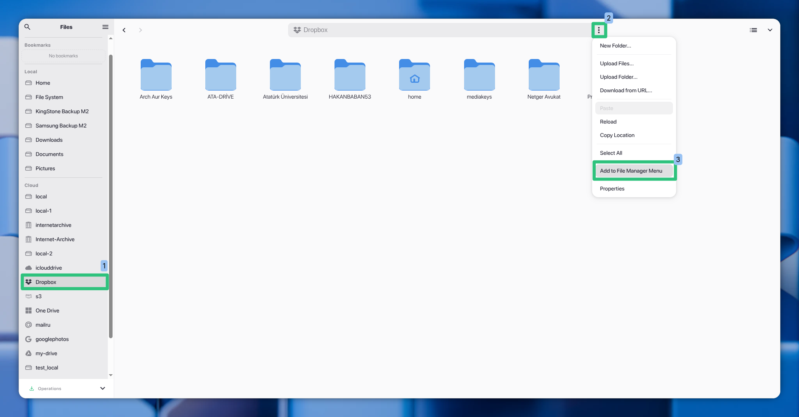

# [[icon:extension.primary]] File Manager Integrations

RClone Manager provides native file manager integrations across Windows, Linux, and macOS. This allows you to right-click files or folders in your system's file manager and upload them directly to a configured cloud remote in the background. On Android, files reach the app through the system **Share** menu instead.

---

## [[icon:settings.primary]] Context Menu Integration

You can register or unregister context menu integrations directly from the **File Browser** in the RClone Manager GUI.

### How to Register a Remote Integration

To register the integration for a specific remote folder:

1. **Select the Remote (1)**: In RClone Manager's built-in File Browser, select the target remote from the **Cloud** list on the left sidebar (e.g., **Dropbox**).
2. **Open Path Options (2)**: Navigate to the target folder, and click the vertical 3-dots icon on the right side of the path bar at the top (or right-click the empty area in the file browser pane).
3. **Register (3)**: Select **"Add to File Manager Menu"** from the dropdown menu.



To unregister and clean up the context menu actions for a path:

- Open the path options menu (3-dots or right-click) at the registered path and select **"Remove from File Manager Menu"**.


> [!NOTE]
> **Names**: Each registration is named after its remote and path, for example `Dropbox - Backups (RClone Manager)`, and the menu entry reads **Upload to** followed by that remote and path. Use **Remove from File Manager Menu** to unregister one.

> [!NOTE]
> **Cleanup**: Uninstalling with the Windows installer or a DEB/RPM package removes the registered entries automatically (see Uninstallation Clean-up below). Other installs have no uninstaller; unregister your paths in the app first.

### Windows (Windows Explorer)

RClone Manager creates two types of context menu shortcuts:

1. **Cascading Right-Click Submenu**: Adds an **"RClone Manager"** cascading submenu directly in your first-level context menu (under _Show more options_ on Windows 11). Hovering over it displays **"Upload to [Remote]"** with the custom RClone Manager icon.
2. **Send To Shortcut**: Adds a shortcut inside your `%APPDATA%\Microsoft\Windows\SendTo` directory. This is useful for bulk-sending multiple selected files into a single queue.

### Linux (Nautilus, Dolphin, Nemo)

RClone Manager integrates with the most popular Linux file managers:

- **KDE Dolphin**: Registers service menus under `~/.local/share/kio/servicemenus/` as desktop actions, showing up directly in your right-click menu.
- **Nautilus (GNOME)**: Installs a Python extension (`MenuProvider`) in `~/.local/share/nautilus-python/extensions/` to add native context-menu options, along with a fallback shell script in `~/.local/share/nautilus/scripts/`. Nautilus loads the extension only when the `nautilus-python` package is installed; without it, use the entry under **Scripts** in the right-click menu.
- **Nemo (Cinnamon)**: Adds custom Nemo actions in `~/.local/share/nemo/actions/`.

> [!NOTE]
> All Linux context menu desktop and script templates automatically support system localization and are marked with execution permissions (`0o755`) to prevent security warning prompts.

> [!IMPORTANT]
> **Flatpak Users**: If you are using the Flatpak version of RClone Manager and want to use the Context Menu Integration, you must grant the application access to your home directory. This is required both to write the integration files (extensions, scripts) to your host user directory and for the application to access files to upload when triggered from the context menu:
>
> ```bash
> flatpak override --user io.github.zarestia_dev.rclone-manager --filesystem=home
> ```
>
> _(Or enable the **Home folder** permission under **Filesystem** in Flatseal)._

### macOS (Finder)

Registers a Finder Quick Action (Service) bundle in `~/Library/Services/` using Automator zsh-action workflows. You can trigger it from Finder's **Quick Actions** menu.

### Android (Share menu)

Android has no file manager menu to register, so there is nothing to add under **Add to File Manager Menu**. RClone Manager instead appears in the system **Share** sheet of other apps (Gallery, Files and so on) for one file, several files or text:

1. Share the files to **RClone Manager**. Shared text arrives as a text file.
2. The files are copied to the app cache and the file browser opens.
3. Choose the destination remote and folder, then confirm. The upload starts after you confirm.

---

## [[icon:delete.primary]] Uninstallation Clean-up

Removing RClone Manager with its installer or package takes the registered entries with it:

- **Windows**: The installer (both NSIS `.exe` and WiX `.msi` packages) removes the custom registry keys and the `.lnk` shortcuts in your SendTo folder on uninstall. This covers both the desktop app and the server.
- **Linux**: The DEB and RPM packages run a pre-removal script that deletes the Nautilus scripts and Python extensions, Dolphin service menus and Nemo actions of the product being removed, in `/root` and in every user's home under `/home`.
- **macOS**: Dragging the app to the Trash does not remove your user service bundles. Choose **Remove from File Manager Menu** in the app first; it deletes the `.workflow` folder.

AppImage, Flatpak, portable and standalone server installs have no uninstaller, so entries registered from them stay until you remove them with **Remove from File Manager Menu**.
